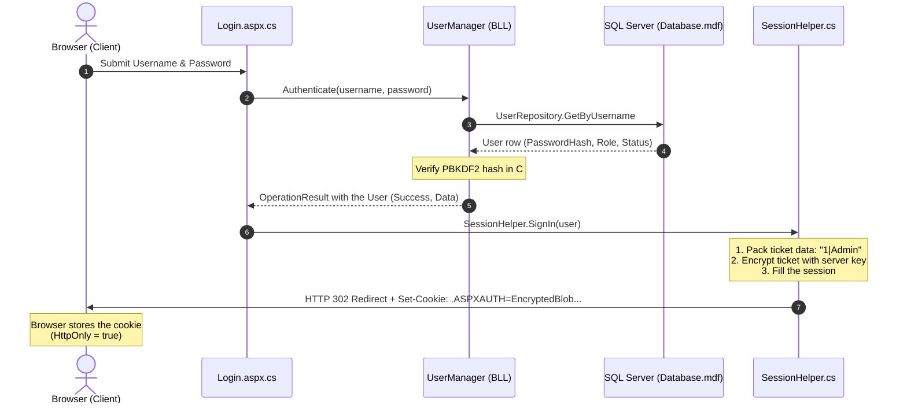
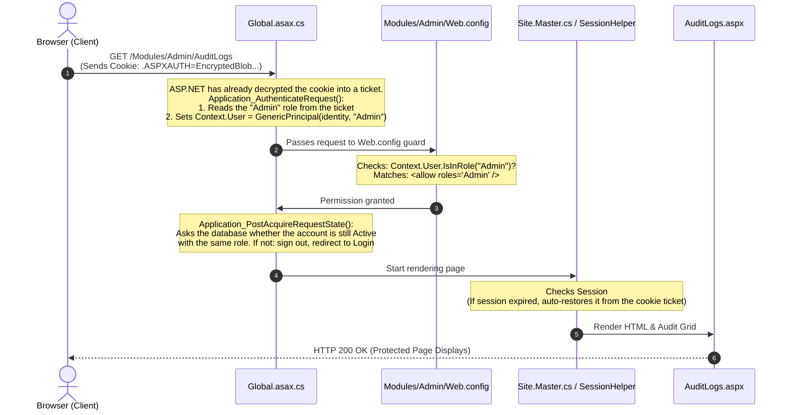

# CodeLab

> **Platform**: ASP.NET Web Forms Web Application (.NET Framework 4.7.2)  
> **Development Database**: LocalDB (`(LocalDB)\MSSQLLocalDB`)

CodeLab is an interactive learning and quiz platform built with ASP.NET Web Forms, structured with a 3-tier architecture (Presentation, Business Logic, and Data Access Layers).

---

## Getting Started

### 1. Prerequisites
* **Visual Studio 2022** (with *.NET desktop development* and *ASP.NET and web development* workloads).
* **SQL Server Express LocalDB** (included with Visual Studio).
* `sqlcmd` available on your `PATH`.

### 2. Create the database
Stop the site, then run `CodeLab\App_Data\SetupDatabase.cmd`. It builds `App_Data\Database.mdf` in LocalDB, creating the file first if it does not exist, by running three scripts in order:

1. `DropAllTables.sql` deletes every table and all data, so each run starts clean.
2. `Schema.sql` creates the tables.
3. `DemoData.sql` adds the demo accounts, courses, lessons, quizzes, coding challenges and learner progress.

It asks before deleting anything. Run `SetupDatabase.cmd /y` to skip the question. Run it again whenever you want a fresh copy of the demo data.

Demo accounts (development only, the passwords are public, so never use this data on a real server):

| Role | Accounts | Password |
|---|---|---|
| Admin | `admin` | `Admin@123` |
| Tutor | `tutor`, `grace`, `ada` | `Tutor@123` |
| Tutor applicants, waiting for review | `helena`, `marcus` | `Tutor@123` |
| Learner | `learner`, `alice`, `ben`, `chloe`, `daniel`, `emma`, `farid`, `gracelee`, `hiro` | `Learner@123` |
| Suspended learner | `ivan` | `Learner@123` |

Course covers and profile photos are files in `CodeLab/Uploads/Covers` and `CodeLab/Uploads/Avatars`. The demo data only stores their paths, so keep those files.

---

## Authentication & Cookie Architecture

Security is enforced at two distinct boundaries:
1. **URL & Folder Authorization**: Scoped `Web.config` files in `Modules/` folders (`<allow roles="..." />` then `<deny users="*" />`) are checked against `Context.User`, which `Global.asax.cs` fills with the role from the login cookie.
2. **Business Logic Layer**: BLL managers (for example `AuditManager`, `TutorManager`, `CourseManager`) call `SessionHelper.IsUserInRole(...)` before performing role-specific actions.

### How Cookies & Sessions Work Together

* **Forms Authentication Cookie**: The security authority. Holds the encrypted ticket with the username and `UserData` (`UserID|Role`). ASP.NET validates it on every request; `Global.asax.cs` then reads the role from the ticket so the folder `Web.config` rules can use it.
* **Session State**: Fast server-memory cache of `UserID`, `Username`, `FullName` and `Role`, read through `SessionHelper`. If the session is lost while the cookie is still valid, it is rebuilt from the cookie ticket (the full name is reloaded from the database).
* **Account check**: once per page request, `Global.asax.cs` (`Application_PostAcquireRequestState`) asks the database whether the account is still Active and still has the role in the ticket. If not, it signs the user out and sends them to the login page with a message, so an admin's suspension or role change applies on the user's next click.
* Both the cookie (`<forms timeout="60">`) and the session (`<sessionState timeout="60">`) last 60 minutes; the cookie slides.

```text
┌────────────────────────────────────────────────────────┐
│  FormsAuthenticationTicket                             │
├─────────────────┬──────────────────────────────────────┤
│ Name            │ "admin_user"                         │
│ Issue Date      │ 2026-10-14 17:45:00                  │
│ Expiration Date │ 2026-10-14 18:45:00 (60 min timeout) │
│ UserData        │ "1|Admin"  <-- (UserID | Role)       │
│ CookiePath      │ "/"                                  │
└─────────────────┴──────────────────────────────────────┘
                           │
                 [ Encrypted by Server ]
                           ▼
          .ASPXAUTH = 8F3D9A1B4C7E... (HttpOnly)
```

The cookie is only marked `Secure` (HTTPS-only) when `requireSSL="true"` is set on the `<forms>` element. It is off by default so login works over `http://localhost`; turn it on for production (see below).

### 1. Cookie Generation at Login



### 2. Request Authorization Flow



### Known limitations and production checklist

* **Logout does not revoke copied cookies.** Forms authentication is stateless: a copy of the cookie saved before logout is still accepted until it expires (60 minutes).
* **Suspensions and role changes apply on the next page request.** The account check runs once per page (images and scripts skip it), not in the middle of a request. If the database is down, the check lets users stay signed in, so a database problem cannot sign everyone out.
* **Set `requireSSL="true"`** on the `<forms>` element (for example with a `Web.Release.config` transform) and serve the site over HTTPS in production.

---

## Directory Structure

```text
CodeLab/                          # Repository root
├── README.md                     # Project overview and quickstart
├── CONTRIBUTING.md               # Detailed architectural & coding rules
└── CodeLab/                      # Visual Studio Web Application Project
    ├── App_Data/                 # SetupDatabase.cmd, DropAllTables.sql, Schema.sql, DemoData.sql
    ├── App_Start/                # RouteConfig & BundleConfig
    ├── Models/                   # Plain Old CLR Objects (POCOs)
    ├── DAL/                      # Data Access Layer (ADO.NET SQL queries)
    ├── BLL/                      # Business Logic Layer
    ├── Helpers/                  # Cross-cutting static utilities (SessionHelper, etc.)
    ├── Content/                  # CSS design tokens & Bootstrap
    ├── Scripts/                  # Client-side JavaScript
    ├── Modules/                  # Role-based feature pages
    │   ├── Admin/                # Admin only (Dashboard, Users, Courses, TutorApplications, AuditLogs, Backups)
    │   ├── Tutor/                # Tutor & Admin (CourseEditor, LessonEditor, QuizEditor, ChallengeEditor, Profile, ...)
    │   ├── Learner/              # Learner only (Dashboard, Courses, Curriculum, Discussion pages, ...)
    │   └── Public/               # Anonymous (Login, Register, Courses, CourseDetails)
    ├── UserControls/             # Reusable ASCX components
    ├── Site.Master               # Shared application layout
    └── Web.config                # Root IIS & server configuration
```

For full coding guidelines, database rules, and naming conventions, see [CONTRIBUTING.md](CONTRIBUTING.md).
